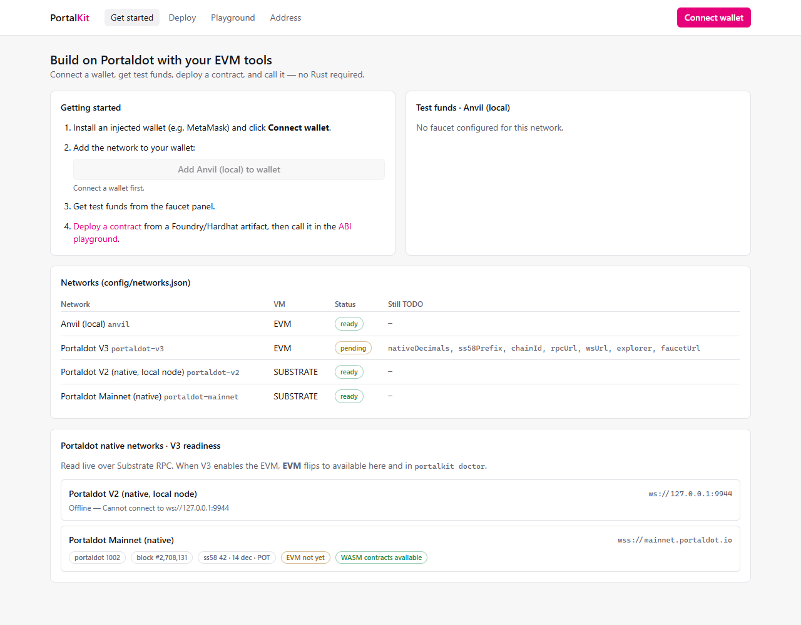
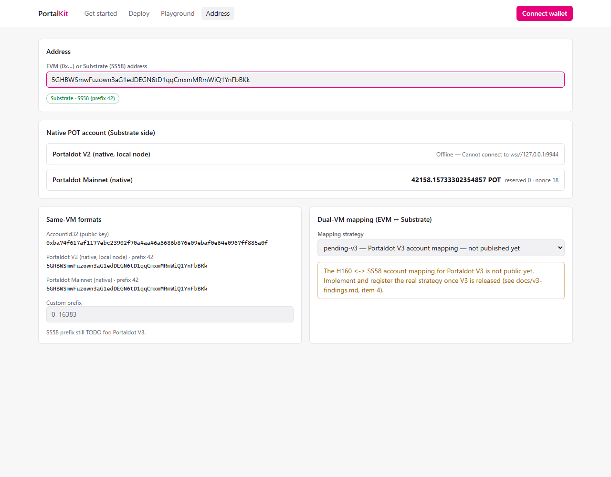
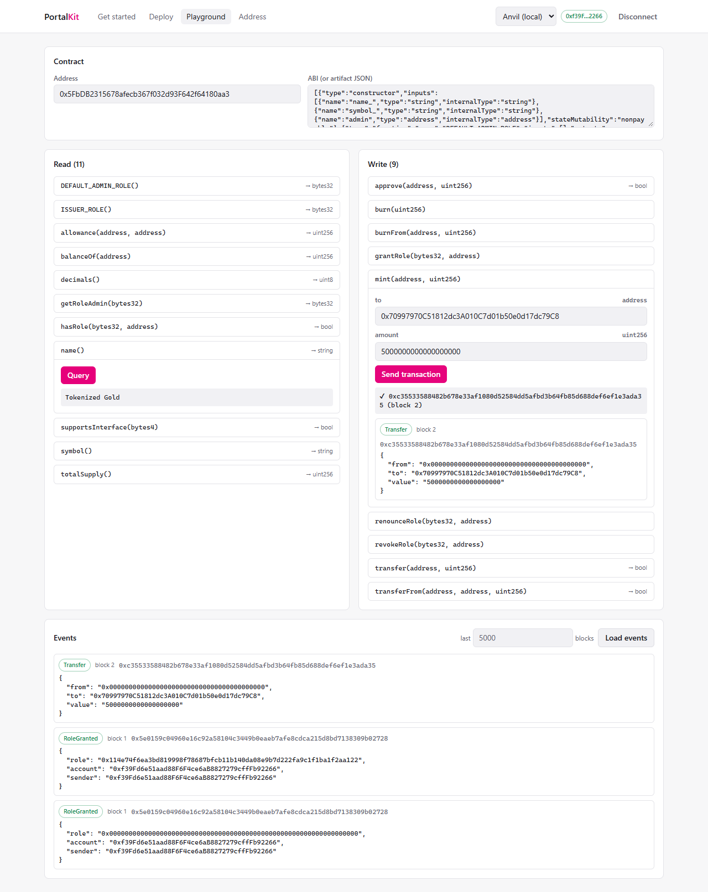
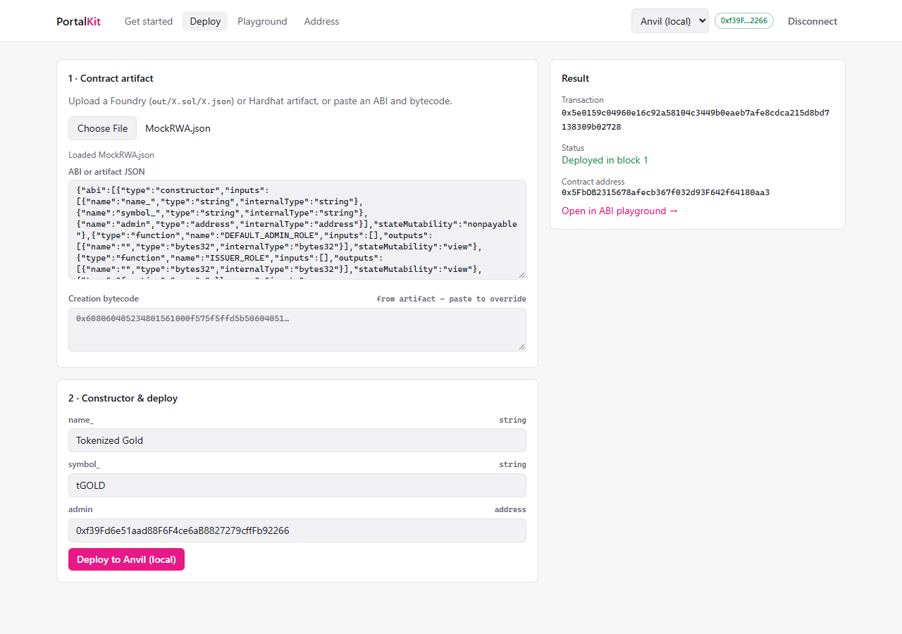
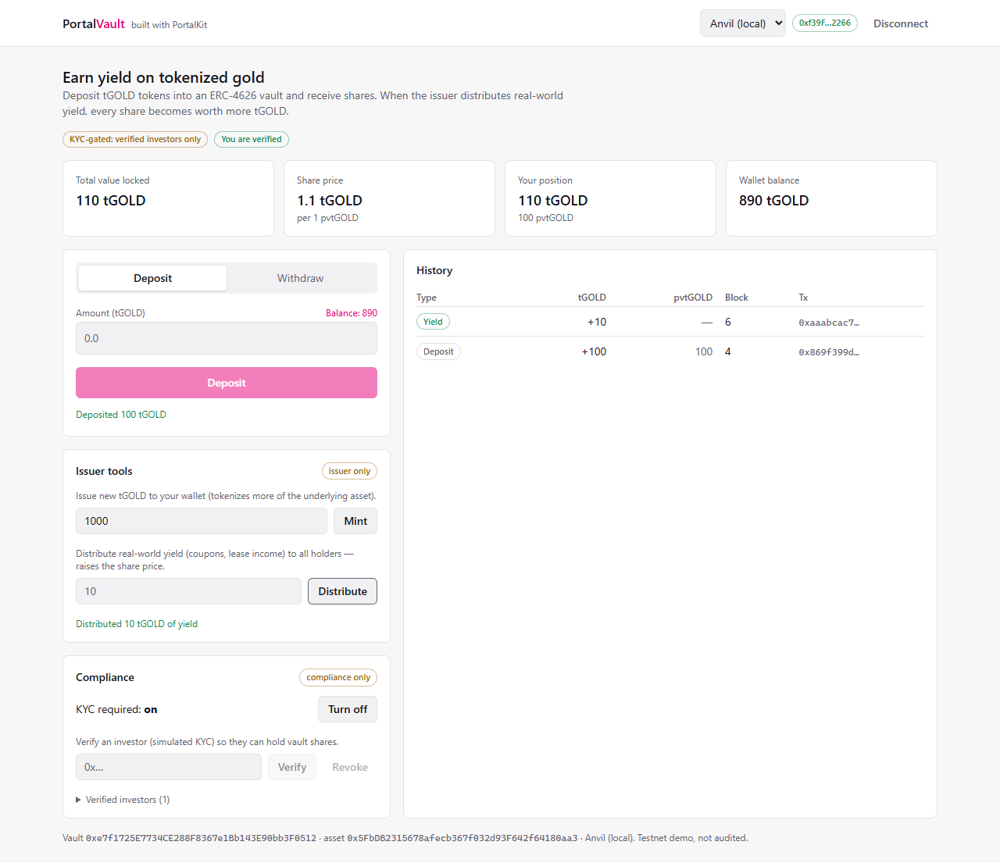
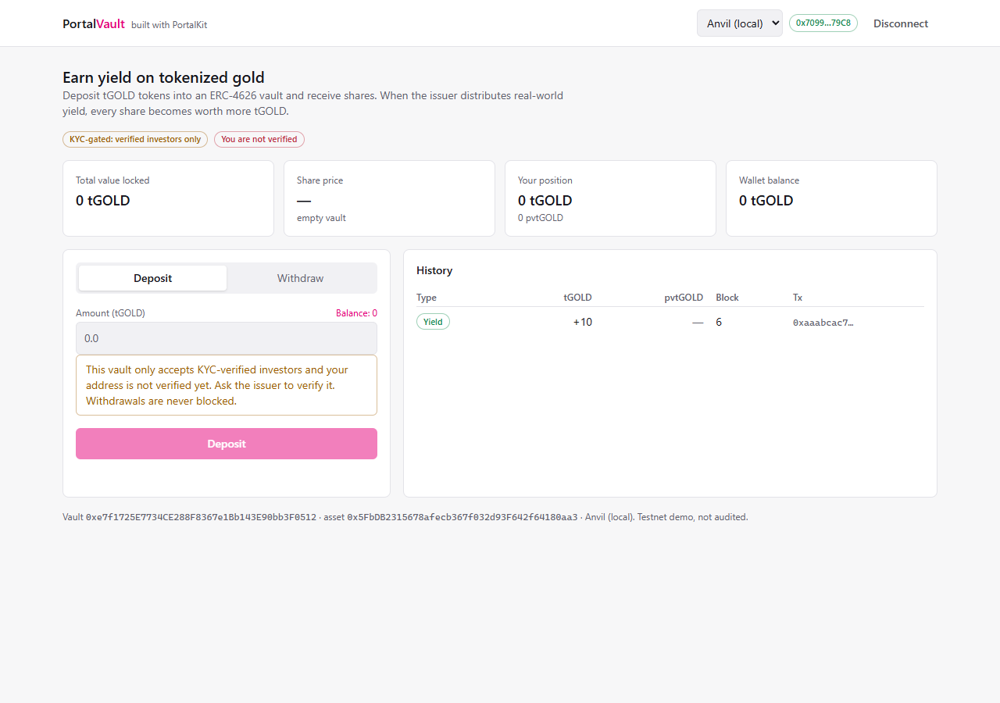
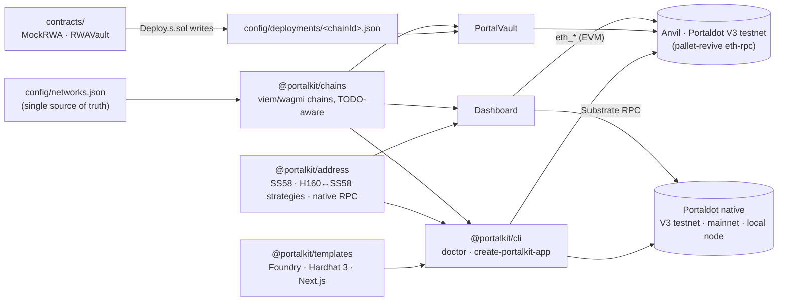

# PortalKit

**Ship Solidity dApps on Portaldot V3 in minutes — and bridge its two worlds (EVM ↔ Substrate) from day one.**
Plus **PortalVault**, a compliance-aware tokenized-RWA vault built entirely with the kit.

> Portaldot Hacker House 2026 · Track: *Ecosystem DApps* or *Modular Cloud & Middleware* (to be confirmed against the official rules).
> **Configured for the live Portaldot V3 testnet** (pallet-revive EVM, chainId 420420777, both its EVM RPC and its
> Substrate node pass `portalkit doctor`), and everything is also tested **Anvil-first**. All values live in
> [`config/networks.json`](config/networks.json). The native side also runs against live Portaldot mainnet.

---

## The problem

Portaldot V3 adds an EVM next to its Substrate runtime. That should bring in the largest developer pool in crypto — Solidity
developers — but today they hit a wall:

1. **No path in.** Which RPC? Which chainId? Where do I get POT for gas? These were the top complaints from the previous
   Portaldot hacker house. Every team rebuilds the same scaffolding (contracts + wallet + chain config) from scratch.
2. **Two account worlds.** Portaldot users have SS58 accounts (`5Grw…`) with 14-decimal POT on the native side; EVM tools
   speak H160 (`0xf39F…`). Nothing shows a developer both sides at once.
3. **Old, quirky native runtime.** The live chain runs a Substrate 3.0-era runtime (`portaldot` spec 1002) that current
   `@polkadot/api` cannot fully decode — so even "what is this account's POT balance" needs custom work.
4. **Opaque failures.** A wrong chainId, a node without standard `eth_*` methods, or an unfunded deployer show up as cryptic
   transaction errors instead of a clear diagnosis.

## The solution

| | What it is | Why it matters for Portaldot |
|---|---|---|
| **`create-portalkit-app`** | One command scaffolds a working dApp: **Foundry or Hardhat 3** contracts + Next.js/wagmi web app, wired to the project's own `networks.json`; deploy with `pnpm deploy:anvil` | From zero to a dApp you can click in minutes; both presets verified end-to-end |
| **`portalkit doctor`** | Pre-flight checks for a network. **EVM:** RPC alive, chainId matches config, the 9 `eth_*` methods tools rely on, deployer funded. **Native:** node reachable, SS58 prefix / POT decimals / symbol match config, runtime, **whether the node exposes EVM and WASM contracts**, SS58 account balance | Turns cryptic failures into a red line with a reason; **tells you the moment V3's EVM goes live** |
| **`@portalkit/chains`** | viem/wagmi chain definitions generated from one config file; `TODO`-aware (pending networks are reported, never half-built) | Config-driven: filling in V3's values is the only change needed |
| **`@portalkit/address`** | SS58 helpers, **pluggable H160 ↔ SS58 mapping strategies**, and raw-RPC helpers for Portaldot's native side (account decoder verified on mainnet) | The dual-VM foundation; V3's real mapping plugs in without touching callers |
| **Dashboard** | Connect wallet + one-click *add network* · **deploy wizard** (Foundry/Hardhat artifact → auto-generated constructor form) · **ABI playground** (read/write any contract, decoded events) · **address converter** with the **live native POT balance** of any SS58 account · faucet panel · **V3 readiness** monitor | Everything a Solidity dev needs in a browser — no scripts |
| **PortalVault** | `MockRWA` (tokenized gold) + `RWAVault` (ERC-4626): deposit, issuer-distributed yield, withdraw, history · **simulated KYC** (only verified investors hold shares; withdrawals never blocked) | Proves the kit end-to-end and hits Portaldot's tokenized-RWA narrative, compliance included |

### Live on Portaldot V3 testnet today

```text
$ portalkit doctor -n portaldot-v3 --address 0xd9838a86cf83c28ee486544060d1ca4ca2971071
✔ Network config                 Portaldot V3 Testnet (chainId 420420777) → https://test-evm-rpc-v3.portaldot.dev
✔ RPC reachable                  block #118914 in 996 ms
✔ chainId matches config         420420777
✔ Standard Ethereum JSON-RPC     9 required methods OK
✔ EIP-1559 & client info         all supported
✔ Deployer balance               182.9884679822373337 tPOT (0xd9838a86cf83c28ee486544060d1ca4ca2971071 via --address)

$ portalkit doctor -n portaldot-v3-native --address 5GyuKkF3Hpv6aRwFa5BtcWvXLqGDjGfMLi1f2jFraJ4Zuef5
✔ Node reachable                 PortaldotV3 Test · node 3.0.0-dev-fddd43141f2 · block #118915
✔ Chain properties match config  ss58 42 · 14 decimals · tPOT
✔ Runtime                        portaldot-v3 spec 3002
✔ Execution environments         EVM: available · WASM contracts: available
✔ Account balance                183.08846798223733 tPOT free · nonce 2
```

The same account seen from both VMs: `0xd983…1071` maps to `5Gyu…uef5` (`H160 ++ 0xEE×12`), and the EVM side reports
the native 14-decimal balance with 18 decimals (minus the existential deposit).

Mainnet (V2, native only):

```text
$ portalkit doctor -n portaldot-mainnet --address 5GHBWSmwFuzown3aG1edDEGN6tD1qqCmxmMRmWiQ1YnFbBKk
✔ Network config                 Portaldot Mainnet (native) (substrate) → wss://mainnet.portaldot.io
✔ Node reachable                 Portaldot Mainnet · node 2.0.0 · block #2708129
✔ Chain properties match config  ss58 42 · 14 decimals · POT
✔ Runtime                        portaldot spec 1002
✔ Execution environments         EVM: not available · WASM contracts: available
✔ Account balance                42158.157… POT free · nonce 18
```

## Screenshots

| Dashboard — V3 readiness (live mainnet) | Dashboard — native POT account + dual-VM converter |
|---|---|
|  |  |
| **Dashboard — ABI playground (decoded events)** | **Dashboard — deploy wizard** |
|  |  |
| **PortalVault — yield raised the share price to 1.1** | **PortalVault — unverified investor (KYC)** |
|  |  |

## Quickstart

Requirements: Node ≥ 22 (24 recommended), pnpm, [Foundry](https://book.getfoundry.sh/getting-started/installation).

```bash
git clone git@github.com:cris-the-dev/portaldot-hackathon.git portalkit
cd portalkit && git submodule update --init
pnpm install && pnpm build

anvil                                                   # terminal 1
cd contracts && PRIVATE_KEY=0xac0974bec39a17e36ba4a6b4d238ff944bacb478cbed5efcae784d7bf4f2ff80 \
  forge script script/Deploy.s.sol --rpc-url anvil --broadcast   # Anvil dev key #0 — local only
cd .. && pnpm -F @portalkit/dashboard dev               # http://localhost:3000
pnpm -F @portalkit/vault-app dev                        # http://localhost:3001

node packages/cli/dist/portalkit.js doctor -n portaldot-v3        # V3 testnet EVM RPC
node packages/cli/dist/portalkit.js doctor -n portaldot-v3-native # V3 testnet Substrate node
```

Full walkthrough (scaffolding a new app, dashboard tour, vault demo, deploying to V3 testnet): [`docs/quickstart.md`](docs/quickstart.md).

## Architecture



Design rules: **config-driven** (no hardcoded chainId/RPC/addresses), **TODO-aware** (unknown V3 values are explicit and reported,
never guessed), **Anvil-first**, **strategy pattern** for anything V3 hasn't specified yet (H160 ↔ SS58 mapping).
Details: [`docs/architecture.md`](docs/architecture.md).

## Repository

```
packages/chains     @portalkit/chains      viem/wagmi chains from config
packages/address    @portalkit/address     SS58, mapping strategies, native RPC helpers
packages/cli        @portalkit/cli         portalkit doctor + create-portalkit-app
packages/templates  @portalkit/templates   Foundry / Hardhat 3 / Next.js templates
apps/dashboard      Dashboard (Next.js 16, wagmi 3)
apps/vault          PortalVault frontend (Next.js 16, wagmi 3)
contracts/          Foundry: MockRWA, RWAVault (ERC-4626 + KYC), deploy script
config/             networks.json + deployments/<chainId>.json
docs/               quickstart, architecture, v3-findings, video script, evidence
```

**Quality:** 60 Foundry tests (incl. fuzzing and an inflation-attack scenario) · 91 Vitest tests + opt-in live tests ·
browser E2E smoke tests for the dashboard and vault · CI on every push (lint, typecheck, tests, `forge fmt`/`build`/`test`).

## Status & roadmap

| | Status |
|---|---|
| Kit, dashboard, vault on Anvil | ✅ done, E2E-tested |
| Native side on Portaldot mainnet (doctor, native account view, V3 readiness) | ✅ live |
| V3 testnet in `networks.json` + `portalkit doctor` | ✅ EVM RPC + Substrate node verified live 2026-10-20 ([findings](docs/v3-findings.md)); explorer/faucet not announced |
| Real H160 ↔ SS58 strategy | ✅ `revive`: H160 → SS58 (`H160 ++ 0xEE×12`) with the guide's test vector · ⏳ native SS58 → H160 |
| Contracts deployed on Portaldot V3 testnet + tx evidence | ⏳ [`docs/evidence.md`](docs/evidence.md) |
| `npx create-portalkit-app` | ⏳ packages ready; npm publish pending (works today via `--portalkit <path>`) |

**Next on V3:** fund the deployer's mapped SS58 address (shown by the dashboard) → `forge script … --rpc-url portaldot_v3
--broadcast` (V3 runs plain solc bytecode; dry-runs of both contracts already succeed) → record evidence. If V3 ships an EVM ↔ native/WASM precompile, the dashboard grows a true **dual-VM view**
(one account, both balances, calls across VMs).

**After the hackathon:** publish the npm packages, contract verification + explorer links once Portaldot has an EVM explorer,
ink!/WASM templates next to Solidity ones, and a hosted dashboard for the community.

## Team

_TBD — names and roles._

## License

[MIT](LICENSE).
